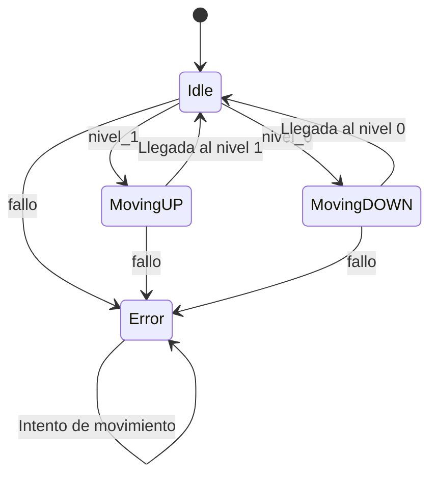

# Examen1 PMDM

## 1. Estados

| Estado | Descripción |
|---|---|
| `Idle` |Está parado en uno de los niveles. |
| `MovingUP` | Está subiendo. |
| `MovingDOWN` | Está bajando. |
| `Error` | Se ha producido un fallo. |

## 2. Variables
La variable `nivel_actual` guarda el nivel en el que se encuentra en ese momento.

| variable | Significado |
|---|---|
|`0` | Nivel Avenida García Barbón.|
|`1` | Nivel Plaza de Compostela.|
|`2` | Está en movimiento.|
|`-1`| Está en error.|

La variable `estado_acual` guarda el estado actual de la máquina.

También están `nivel_0` y `nivel_1` que son los botones.

## 3. Transiciones entre estados
Las transiciones se controlan con las funciones de `Gestor.kt`.

- Desde `Idle`, pulsar `nivel_1` en el nivel 0 inicia la subida.
- Cuando termina la subida, llega al nivel 1 y vuelve a `Idle`.
- Desde `Idle`, pulsar `nivel_0` en el nivel 1 inicia la bajada.
- Cuando termina la bajada, llega al nivel 0 y vuelve a `Idle`.
- Si se produce un fallo, la máquina pasa al estado `Error`.

Cuando la máquina está en movimiento, `nivel_actual` vale `2`. Si se produce un error, vale `-1`.

## 4. Diagrama de estados

### 5. Tests
Los tests comprueban:

- El estado y nivel iniciales.
- Las subidas y bajadas.
- La llegada a cada nivel.
- Los fallos si ya estan en el nivel correspondiente
- Los fallos desde los estados normales.

Se utiliza `@AfterTest` para restaurar las variables después de cada prueba y evitar que los resultados dependan del test anterior.

